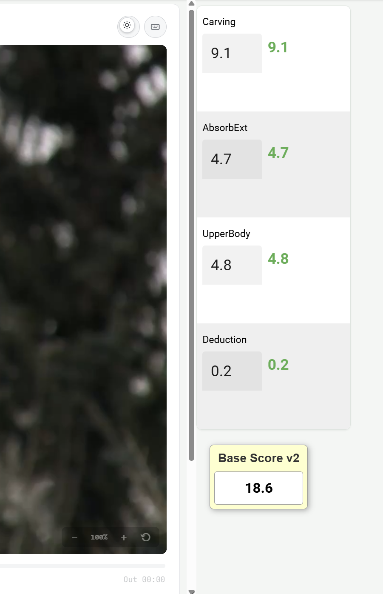

# Base Score Helper for Judge Click

---
## Overview

This bookmarklet detects and sums the **top three score inputs in the right-side score area** of Judge Click. It displays the calculated **Base Score** in a draggable panel and runs from a browser bookmark without requiring an extension.

---

| **Summary** | **Base Score Example** | **Short Video** |
|----------|----------|----------|
| Adds the scores from the three right-side Turn categories and displays their total in a Base Score panel. Use it when all three categories are visible. |  | [Watch the short demo](screenshots/Base_Score.gif) |

---

## Key Features

- 🎯 **Auto-sum of Top 3 Inputs** — Detects the top three score fields in the right-side area, with a fallback if needed.
- 📦 **Floating Base Score Panel** — Draggable, always on top, very light and readable.
- ⛔ **Script Toggle (S key)** — Hide/show the Base Score box and stop/start updates.
- ⚡ **Very lightweight** — Updates every 200ms, minimal impact on performance.

---

## To Use

Open the Judge Click scoring page with all three Turn categories visible, then click your saved **Base Score Tool** bookmark. The bookmarklet only runs on `judge.click`.

---

## To Disable

Refresh the Judge Click page to stop the bookmarklet.

---

## Install the Bookmarklet

1. Create a bookmark in your browser and name it **Base Score Tool**.
2. Open [the minified bookmarklet](code/bookmarklet_v2.0.min.txt) and copy the entire line.
3. Edit your bookmark and paste the copied text into its URL or location field. Confirm the URL starts with `javascript:`, then save the bookmark.
4. Open the Judge Click scoring page with all three Turn categories visible and click **Base Score Tool** bookmark

If the bookmarklet does not run, confirm its URL still starts with `javascript:` and that you are on the Judge Click scoring page with all three Turn categories visible. Reopen the bookmark editor and save it again if needed.

---

### Safari Setup

On macOS, Safari may require web developer features to be enabled. Follow the [macOS Safari setup instructions](macOS%20Safari%20setup.md) if needed.

---

## Supported Devices

- **Windows 11:** Chrome, Edge, and Firefox.
- **macOS:** Chrome and Safari. Safari requires the setting described below.
- **iPadOS:** Safari. To use Chrome, first create the bookmark in Safari, then copy its URL into Chrome.
- **Android:** Not supported. iPhone support is unverified, and the small screen may limit use.

---

## Hotkey Controls

| Key   | Function                             |
| ----- | ------------------------------------ |
| **D** | Toggle debug labels on/off - Default is off          |
| **S** | Toggle script (Base Score UI) on/off |

---

## Script Behavior

| Feature           | Behavior                                               |
| ----------------- | ------------------------------------------------------ |
| Score Detection   | v2.0 targets the top 3 inputs in the right-side score area first (with fallback). |
| Panel Dragging    | Drag from the yellow background (not from the sum box) works with mouse or touch screen |
| Debug Labels      | Display ranking & numeric value ribbon above inputs    |
| Real-time Updates | 5 updates per second (200ms interval)                  |

---

## Code

The bookmarklet is self-contained. For the readable source, see [Judge_Click_in_console_v2.0.js](code/Judge_Click_in_console_v2.0.js).

---

## Enhancements Roadmap

- Remember the panel position between sessions.
- Add color themes and larger text options.
- Add drag handles to debug labels.
- Explore a Chrome extension with Manifest V3.

---

## License

MIT License — free to use, modify, share.

---

## Author

Created by freedogski, optimized for real competition scoring workflows.

---

