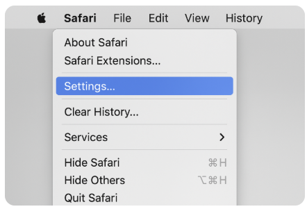

# Enable Bookmarklets in Safari on macOS

Safari may require web developer features to be enabled before bookmarklets can run.



## Enable the setting

1. Open Safari.
2. In the menu bar, choose **Safari > Settings...**. In older macOS versions, this menu item is called **Preferences...**.

3. Select the **Advanced** tab.
4. Turn on **Show features for web developers**.

Safari adds the **Develop** menu. You can now try your bookmarklet on the Judge Click scoring page.

## Optional: Test bookmarklets

1. Create a new bookmark in Safari.
2. Edit its URL and replace it with this single line:

	```text
	javascript:(function(){alert('JavaScript is running!');})();
	```

3. Save the bookmark, open any webpage, and click the test bookmark.
4. If an alert appears, Safari ran the bookmarklet. You can delete the test bookmark afterward.
